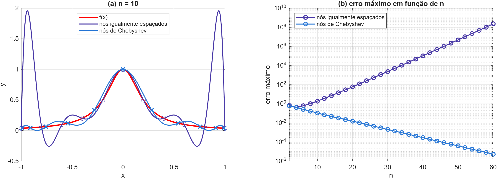
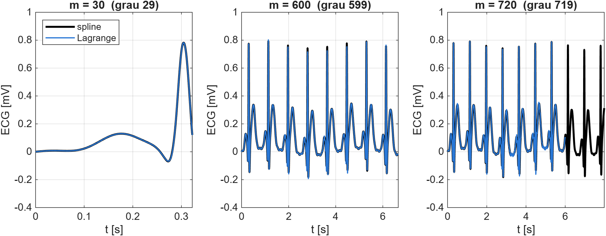

# Lagrange interpolation with Chebyshev nodes (MATLAB)

Coursework project for *Introduction to Computational Methods in Biomedicine*, BSc in Biomedical Engineering, Instituto Superior Técnico, 2026/27. Group of 3 students. Comments and figures are in Portuguese.

## What it does

Implements Lagrange interpolation on Chebyshev nodes and compares it with cubic splines (`interp1`, `'spline'`) and with the theoretical error bound, on three functions and on a synthetic ECG signal.

| Script | Case |
|---|---|
| `main_a_cos.m` | cos(x) on [0, 2π] |
| `main_b_exp.m` | exp(x)·ln(1 + exp(−x)) on [0, 37] |
| `main_c_runge.m` | Runge function 1/(1 + 25x²) on [−1, 1], also with equally spaced nodes |
| `main_ecg.m` | Synthetic ECG (720 samples, 8 s) |

Shared functions: `nos_chebyshev.m` (nodes), `lagrange_interp.m` (interpolation), `derivada_b.m` (derivatives for case b).

## Main results

- **cos(x):** the maximum error falls to about 1e-15 at degree 20 and then stays there, because rounding takes over.
- **exp(x)·ln(1 + exp(−x)):** the error does not fall with the degree. The cause is the evaluation of the function itself, which loses precision for large x, and not the interpolation.
- **Runge function:** with degree 60 the maximum error is 5.4e-6 on Chebyshev nodes and 2.3e8 on equally spaced nodes.
- **ECG:** the polynomial follows the signal without oscillating up to 616 nodes. From 617 nodes the direct Lagrange formula overflows in double precision and returns NaN.

## How to run

Put all files in one folder and run any `main_*.m`. Figures are saved to `figuras/`.

The ECG file `P1_ECG_25pct.csv` was provided by the course and is not included, so `main_ecg.m` needs your own copy with the columns `time_s` and `ECG_mV`.

## Limitation

The direct Lagrange formula is simple but overflows at high degree. The barycentric form would avoid this and was not implemented here.
